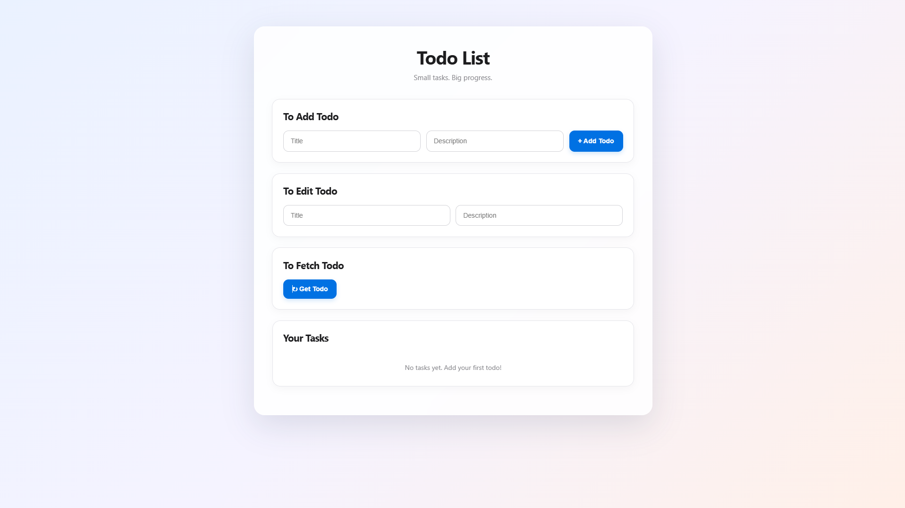

# Full Stack Todo Application

A full-stack Todo application built with HTML, CSS, JavaScript, Node.js, and Express.js, with Docker-based deployment support.

📑 Table of Contents

Overview

Features

Technology Stack

Architecture

Project Structure

Prerequisites

Run Locally

Run with Docker Compose

API Documentation

Screenshots

Troubleshooting

Future Improvements

Contributing

Author

License

📌 Overview

FullStackTodoApp is a learning project focused on building a web application with a separate frontend and backend.

The frontend provides the user interface, while the backend handles HTTP requests and Todo-related operations through an Express API.

The project also explores containerization with Docker and service orchestration with Docker Compose.

Why I built this project

To understand frontend-to-backend communication.

To practice building REST API endpoints with Express.js.

To learn how to organize a full-stack application.

To containerize application services with Docker.

To understand how Nginx can serve frontend files.

To practice running and managing multiple services using Docker Compose.

✨ Features

Todo Management: Create and manage Todo items through the application.

Frontend and Backend Separation: Keep the user interface separate from server-side logic.

REST API: Communicate between the frontend and backend using HTTP requests.

JSON Communication: Send and receive structured JSON data.

Docker Support: Package application services into containers.

Docker Compose: Define and run multiple application services from one configuration.

Nginx: Serve static frontend files in the containerized setup.

Local Development: Run the frontend and backend independently while developing.

Add editing, deletion, completion tracking, or persistent storage to this list only if those features are implemented in your current version.

🛠️ Technology Stack

Technology

Purpose

HTML5

Frontend structure

CSS3

Styling and layout

JavaScript

Frontend interactions and API requests

Node.js

JavaScript runtime for the backend

Express.js

HTTP server and API routes

JSON

Data exchange between frontend and backend

Docker

Containerization

Docker Compose

Multi-container application management

Nginx

Serving static frontend files

🏗️ Architecture

The application follows a simple client-server architecture.

                 User / Browser
                       |
                       v
                Frontend UI
               HTML / CSS / JS
                       |
                 HTTP Requests
                       |
                       v
                Express Backend
                  Node.js API
                       |
                       v
              Todo Operations

Docker architecture

              Docker Compose
                     |
          +----------+----------+
          |                     |
          v                     v
   Frontend Service       Backend Service
        Nginx                 Node.js
          |                     |
          v                     v
     Port 8080              Port 3000
          |                     |
          v                     v
    Browser UI          Express REST API

The frontend sends requests to the backend API. Docker Compose defines the services and their configuration so the application can be started and stopped together.

📂 Project Structure

FullStackTodoApp/
├── backend/
│   ├── package.json
│   ├── Dockerfile
│   └── ...                 # Express application files
│
├── frontend/
│   ├── Dockerfile
│   └── public/
│       ├── index.html
│       ├── style.css       # If present
│       └── script.js       # If present
│
├── docker-compose.yml
├── .gitignore
└── README.md

The structure above illustrates the main application directories. Keep the filenames in this diagram aligned with the files actually present in your repository.

⚙️ Prerequisites

Install the following tools before running the application:

Node.js

npm

Git

Docker Desktop or Docker Engine with the Compose plugin

Verify your installations:

node --version
npm --version
git --version
docker --version
docker compose version

💻 Run Locally

1. Clone the repository

git clone https://github.com/satishkumarpeddi/FullStackTodoApp.git
cd FullStackTodoApp

2. Start the backend

Open a terminal:

cd backend
npm install

Start the server using the script defined in backend/package.json. For example, if the project defines a start script:

npm start

If it defines a development script, use npm run dev instead.

The backend is expected to listen on port 3000 in the current Docker configuration.

3. Start the frontend

Serve the files inside frontend/public using a local static-file server, or use the frontend's configured development setup if one exists.

For the Docker-based setup, the frontend is served by Nginx.

4. Open the application

Frontend: http://localhost:8080

Backend: http://localhost:3000

These addresses assume the port mappings shown in the Docker Compose configuration.

🐳 Run with Docker Compose

Docker Compose makes it possible to build and start the frontend and backend services together.

1. Check Docker

Make sure Docker Desktop or Docker Engine is running:

docker --version
docker compose version

2. Build and start the services

From the project root:

docker compose up --build

Run the services in the background:

docker compose up --build -d

3. Access the application

Service

Local URL

Frontend

http://localhost:8080

Backend

http://localhost:3000

4. Check running containers

docker compose ps

View logs:

docker compose logs -f

View logs for a particular service:

docker compose logs -f backend
docker compose logs -f frontend

5. Stop the application

docker compose down

To rebuild after making changes:

docker compose up --build -d

Important: The frontend service must have a valid Dockerfile if your Compose configuration uses build: ./frontend. Make sure the backend and frontend Dockerfiles match your actual project.

🌐 API Documentation

The backend exposes Todo-related HTTP endpoints. The table below is a proposed CRUD reference; verify each route and HTTP method against your Express router before treating it as the final API contract.

Base URL:

http://localhost:3000

Method

Endpoint

Purpose

GET

/todos

Retrieve Todo items, if implemented

POST

/todos

Create a Todo item

PUT or PATCH

/todos/:id

Update a Todo item, if implemented

DELETE

/todos/:id

Delete a Todo item, if implemented

Example: Create a Todo

Request

POST /todos
Content-Type: application/json

Request body

{
  "title": "Learn Docker",
  "description": "Containerize my full-stack application"
}

Example JavaScript request

const response = await fetch("http://localhost:3000/todos", {
  method: "POST",
  headers: {
    "Content-Type": "application/json"
  },
  body: JSON.stringify({
    title: "Learn Docker",
    description: "Containerize my full-stack application"
  })
});

const result = await response.json();
console.log(result);

The exact response format and status code depend on the implementation of your Express route.

Suggested files:

screenshots/
├── todo-home.png

Once those files exist and are committed, display them here:

### Application Interface

🧰 Troubleshooting

Docker daemon is not running

Make sure Docker Desktop has finished starting before running:

docker compose up --build

Port is already in use

Check whether another application is using ports 3000 or 8080, then stop that process or adjust the Compose port mappings.

Frontend cannot reach the backend

Check that:

The backend container is running.

The API is listening on port 3000.

The frontend is using the correct API URL.

The backend handles CORS correctly if the browser sends requests across origins.

Note: Inside a container, localhost refers to that container itself. If the frontend makes requests from browser JavaScript, use a browser-accessible backend address. If requests originate from another container, use the Compose service name and the backend's internal port.

Frontend returns a 404 or Nginx default page

Verify that the frontend Dockerfile copies the correct files or that the volume mount points to the directory containing index.html.

Backend container exits

Inspect the logs:

docker compose logs backend

Check the startup command, package.json, dependencies, and the paths used by the server.

🚀 Future Improvements

Add persistent storage using a database.

Implement and test complete Todo CRUD operations.

Add input validation and consistent error responses.

Improve frontend responsiveness and accessibility.

Add automated backend API tests.

Add health checks for the Docker services.

Configure a production-ready frontend and backend deployment.

Add a CI workflow to build and test the application.

Add monitoring and structured logging.

🤝 Contributing

Contributions, suggestions, and bug reports are welcome.

Fork the repository.

Create a feature branch.

Make your changes.

Test the application locally.

Commit your changes.

Open a pull request describing your changes.

👨‍💻 Author

Satish Kumar Peddi

GitHub: @satishkumarpeddi

Project: FullStackTodoApp

📄 License

No license is specified here. If you want others to reuse your code under defined terms, add a LICENSE file and update this section to match it.

⭐ If you find this project useful, consider giving the repository a star!

